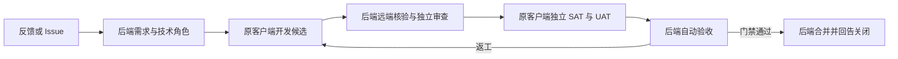

# 仓库问题维护

仓库维护接收反馈或 GitHub Issue，经后端需求分析、技术规划与独立审查后，由 FunnyWork 客户端内置 Agent 开发候选并执行独立验证。自动化仓库由后端验收、合并和回告；兼容仓库保留人工决定。配置与角色分工见[自动维护参考](MAINTENANCE_AUTOMATION.md)。

本文为配置、运行和验收说明；精确字段及客户端身份见 [原客户端任务接口](MAINTENANCE_PROTOCOL.md)，自动化运行及限制见[自动维护说明](MAINTENANCE_AUTOMATION.md)。

FunnyWork 管理端在现有“任务”页受理已明确的问题；原任务、节点、区域、并发额度、attempt、epoch 和恢复代际负责派发。FunnyWork Electron 主进程维护执行器通过 Host 的 Session／Workspace RPC 处理任务。程序负责 Git、固定检查、PR 和回执，内置 Agent 负责规格范围内的代码修改；模型配置与普通客户端账号接入共同维护。

## 启用与试运行

自动仓库先按 [自动维护配置](MAINTENANCE_AUTOMATION.md) 启用后端政策和模型。下列原任务／设备配置继续复用；未启用自动化时才沿用旧的直接创建和人工决定。

1. 更新业务服务和管理前端，按原部署流程应用 V102–V109 迁移，并更新原 FunnyWork 客户端。
2. 在“任务 → 问题 → 仓库”配置 GitHub 仓库、目标分支、授权区域和必要检查。检查使用 argv 数组，必须验证实际需求并适配所选终端。
3. 原客户端登录同一开发后端，管理端在“终端”选择已登记设备并授权维护区域。复用原 history-device-id、设备状态交换、账号身份和后台任务节点；不创建另一个客户端、不生成客户端节点令牌、不配置 maintenance-worker.json。
4. 本机准备 Git、GitHub CLI、仓库权限和提交身份，客户端沿用管理端发布的 DeepSeek Flash V4 API 模型。命令子进程不继承名称含 KEY、SECRET、TOKEN、PASSWORD 的变量，工具登录使用其已有私有凭据存储。
5. 自动仓库由客户端反馈或 Issue 受理，后端需求／产品和技术角色形成明确条件、批准范围及规格后派发；旧直接创建入口仅供未启用自动化的兼容仓库。客户端复用私有 maintenance-workspaces 与普通 Workspace／Session。
6. 客户端提交候选后，自动仓库由后端核对远端、独立审查，派发固定 SAT／UAT 并自动验收；autoMerge 启用且全部门禁通过后由后端合并和回告关闭。未启用自动化的仓库保留人工决定和单独交付授权。

## 最小闭环与状态



| 事件 | 问题状态 | 原任务状态 |
| --- | --- | --- |
| 创建／返工 | IN_PROGRESS | RUNNING |
| 完整候选报告 | AWAITING_ACCEPTANCE | OUTPUT_READY（unit GENERATED） |
| 检查失败／缺环境／运行失败 | BLOCKED | FAILED |
| 后端自动验收（兼容仓库人工决定） | ACCEPTED | SUCCEEDED（unit SUCCEEDED） |
| 后端确认合并及回告关闭 | DELIVERED | SUCCEEDED |
| 取消／撤权／执行中租约过期 | BLOCKED | 原有 CANCELLED／BLOCKED_AUTH／FAILED |

这里 ACCEPTED 表示管理端已验收候选；不表示已合并、发布、交付用户或关闭 Issue。验收记录绑定当前问题版本和具体 candidateSha，不能接受旧版本或另一候选。报告的 `businessVerified=false` 表示后台检查了报告一致性，尚未独立证明代码正确；它不会因人工验收而伪装成可信 CI 证据。自动仓库的后端直接查询 GitHub 核对实际 head、base、diff、CI 与交付结果；旧兼容仓库仍须人工核对。

原通用文本统计 result 和模型 OUTPUT_READY 语义保持不变。维护任务必须通过问题入口建立规格，不能从普通“创建任务”只填写一段文字派发仓库写入。客户端反馈与 GitHub Issues 增量采集、来源归并见[反馈受理](MAINTENANCE_INTAKE.md)。按平台验证与交付流程见[受控交付](MAINTENANCE_DELIVERY.md)。

## 接口

下表中的管理和原节点路径以 `/api/v1` 为根；管理端请求使用原若依身份桥。原客户端的执行路径以 `/api/account/sync` 为根，通过原设备状态交换领取维护帧；续租与结果携带准确 runtimeEpoch，服务端映射到已有任务节点，不向客户端发节点 bearer。表中的 NODE 路径用于后台既有节点机制及相关测试，不是原客户端另外注册 Worker 的步骤。

| 方法与路径 | 身份／作用 |
| --- | --- |
| GET `/maintenance/repositories` | OPERATOR：授权区域内仓库；页面 tasks:read |
| POST `/maintenance/repositories` | ADMIN：仓库、分支、区域、必要检查；页面 agents:write |
| POST `/maintenance/device-bindings` | ADMIN：授权现有客户端设备；页面 nodes:write |
| GET/POST `/maintenance/problems` | OPERATOR：列表／指定需求受理；页面 tasks:read/write；POST 需 Idempotency-Key |
| GET `/maintenance/problems/{id}` | OPERATOR：需求、任务状态、历史／当前报告、验收记录 |
| POST `/maintenance/problems/{id}/decision` | OPERATOR：expectedVersion、accept/rework、note；accept 还需准确 candidateSha |
| POST `/maintenance/nodes/profile` | NODE：platform（macos/windows/linux）、executorVersion、gitVersion |
| POST `/nodes/heartbeat`、`/nodes/poll` | NODE：原在线与领取机制 |
| GET `/attempts/{id}/maintenance/spec?epoch=...` | 当前维护 NODE 租约：不可变 spec、specHash |
| POST `/attempts/{id}/renew` | NODE：原续租，维护规格、平台和仓库仍须匹配 |
| POST `/attempts/{id}/maintenance/result` | NODE：epoch、specHash、outcome、resultSha、prUrl、summary、checks、modelUsage |

维护结果为 CANDIDATE_READY、CHECKS_FAILED、NEEDS_ENVIRONMENT、RUNTIME_FAILED。候选要求准确仓库的 GitHub PR 链接、不同于基线的提交，以及全部已配置检查无重复且 exitCode=0；失败也保存独立报告与产物。重复结果必须内容一致；不一致、旧 epoch、非分配节点、取消或旧恢复代际均拒绝。报告包含本次实际模型请求次数及提供方返回的输入、输出和缓存 token；缺失用量保留 null，不填零。报告大小上限 240000 UTF-8 字节，每项检查输出末尾保留至多 8000 字节。

仓库配置为不可变配置，重复配置返回冲突。运行中的需求规格不被静默编辑；返工说明追加到下一版本，累计需求超过 50000 字符拒绝追加。问题列表目前为授权区域内最近 100 条，没有分页。

## 执行、效率与恢复

每个问题在独立 Git clone 中使用 `funnywork/maintenance-{problemId}` 分支，校验 origin、基线祖先及当前分支。模型负责有限需求的代码修改，程序执行必要检查、提交、推送和 PR 创建／复用；不把模型“完成”文字作为代码证据。检查不得改写候选文件；提交后的树、工作区和 PR head 必须与独立验证的候选一致，否则阻止候选交付。

只有领取任务后才提交原生 Agent 任务。心跳、排队、续租、独立检查、凭据轮换和报告重传不用模型。当前原设备通道最多 2 个维护回合，一个回合可能包含多次模型请求，不能将回合数当作模型调用数或 token 硬预算。检查失败时在同一确定的原生会话中续跑。单个执行步骤最多 10 分钟，读取事件最多 2 MB；权限和审批沿用客户端设置，不自动绕过。

规格、原生会话标识、模型用量及检查结果保存在私有 workspaceRoot 下，不加入候选仓库。ModelUsage.calls 按原生日志记录模型调用数；输入、输出、缓存分别累计，缺失时保持未知。Session RPC 负责模型执行，原生命令负责 Git、必要检查和 PR。Host 代际改变或无法确认取消时保留 RUNNING 日志并停止接单，不能继续仓库写入。

本地 attempt 日志经历 RUNNING → READY → SENT，过期回执为 STALE。正常网络失败只重传 READY 回执，不重新调用模型。后台取消／撤权导致续租失败，停止并等待拥有的子进程；PR 推送和创建前再次续租。退出、登出、恢复停止和安装更新都等待维护进程停止。更新准备已停止执行器而安装失败时，重启客户端后恢复维护接单。

执行中租约过期不自动重派仓库修改，因为旧进程或 GitHub 动作可能尚未确认。客户端非正常退出后存在 RUNNING 日志时停止接单。先确认原生 Agent／检查进程已停止并核对本地分支、远端分支及 PR，再保存诊断副本、移走对应 RUNNING 日志，重启客户端，管理端填写已核对依据后返工。不能凭租约过期推断进程已停止；GitHub 写入超时应先核对既有分支／PR，返工流程查询已有 PR，禁止盲目重复创建。此阶段未建立服务端外部动作对账表。

## 定向检查

按修改范围选择后端维护、调度与恢复检查，以及客户端维护执行器测试。真实仓库试运行前准备 Git、GitHub 权限、模型额度与平台对应的验证命令；实际试运行会创建分支、候选提交和 PR。

```sh
sh scripts/mvn.sh -f services/business/pom.xml -Dtest=MaintenanceIntegrationTest,ControlIntegrationTest,RecoveryGenerationTest,RecoveryIsolationTest,RecoveryEvidenceTrustTest test
cd apps/desktop
pnpm exec vitest run apps/desktop/tests/funnyworker-maintenance.spec.ts apps/desktop/tests/funnyworker-maintenance-agent.spec.ts
pnpm exec tsc -b apps/desktop/tsconfig.host.json
```

管理前端依仓库约定先 build:prod，再 typecheck；仓库布局检查为 `python scripts/checks/check-repository.py`。

原客户端接口：GET `/api/account/sync/maintenance/features` 协商能力；POST `/api/account/sync/devices/{device}/state` 返回 kind=maintenance 帧；POST `/api/account/sync/devices/{device}/maintenance/{attempt}/renew` 续租；POST 同路径 `/result` 回传报告。断线后的 READY 报告重传不再调用模型，旧 runtimeEpoch 的报告保留为 STALE 供核对。
